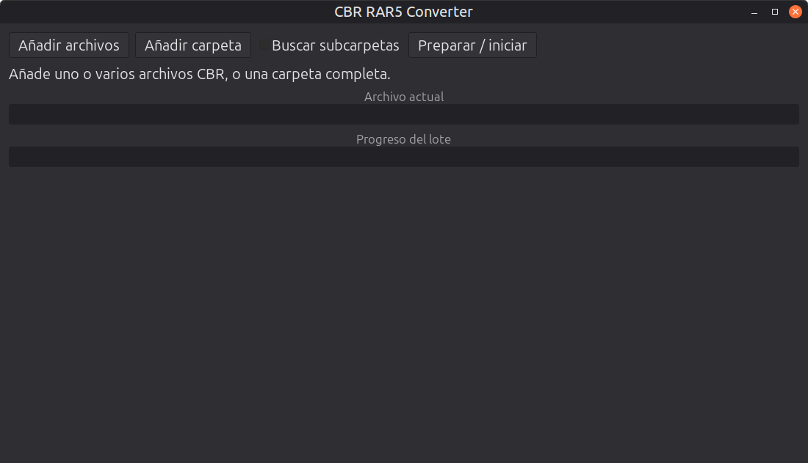

  

<h1 align="center">CBR RAR5 Converter</h1>

  
  
  
  
  
  
  
  
  
  
  
  

## 🇪🇸 Español

  Convierte de forma segura archivos <code>.cbr</code> en formato RAR4 al formato RAR5, sin modificar los
  originales.

  

Aplicación de escritorio (GTK 4 + PyGObject, interfaz en español e inglés), de uso personal: sin servidor ni cuenta,
todo ocurre en tu equipo.

- **Detecta** el formato de cada `.cbr` por su cabecera, no por la extensión.
- **Busca** archivos o carpetas completas, con opción de recorrer subcarpetas.
- **Convierte** de forma segura: temporal, validación de la cabecera RAR5 y sustitución atómica, sin
  sobrescribir destinos existentes.
- **No modifica los originales**: el resultado se guarda en una subcarpeta `Corregido`, preservando la ruta
  relativa.
- **Progreso por archivo y por lote** al convertir varios cómics a la vez.

## Documentación

Toda la documentación —instalación, guía de uso, especificaciones técnicas, solución de problemas y más— está en
la **[wiki del proyecto](https://github.com/seguidodoblado/CBR-RAR5-Converter/wiki)** (español e inglés).

## Privacidad

CBR RAR5 Converter no tiene servidor ni cuenta propios, no se conecta a Internet y no recoge datos. Qué se guarda y dónde está en la **[política de privacidad](PRIVACY.md)**.

## Licencia

Este proyecto se distribuye bajo la GNU General Public License, versión 3 o posterior (ver `COPYING`).

---

## 🇺🇸 English

  Safely converts <code>.cbr</code> files in RAR4 format to RAR5, without modifying the originals.

  

Desktop application (GTK 4 + PyGObject, interface in Spanish and English), for personal use: no server, no account,
everything happens on your own machine.

- **Detects** the format of each `.cbr` from its header, not from its extension.
- **Searches** individual files or whole folders, optionally walking through subfolders.
- **Converts** safely: temporary file, RAR5 header validation and atomic replacement, never overwriting existing
  destinations.
- **Never modifies the originals**: the result is saved in a `Corregido` subfolder, preserving the relative path.
- **Per-file and per-batch progress** when converting several comics at once.

## Documentation

Full documentation —installation, usage guide, technical specifications, troubleshooting and more— is on the
**[project wiki](https://github.com/seguidodoblado/CBR-RAR5-Converter/wiki)** (Spanish and English).

## Privacy

CBR RAR5 Converter has no server or account of its own, does not connect to the Internet and does not collect data. What is stored and where is in the **[privacy policy](PRIVACY.md#-english)**.

## License

This project is distributed under the GNU General Public License, version 3 or later (see `COPYING`).
